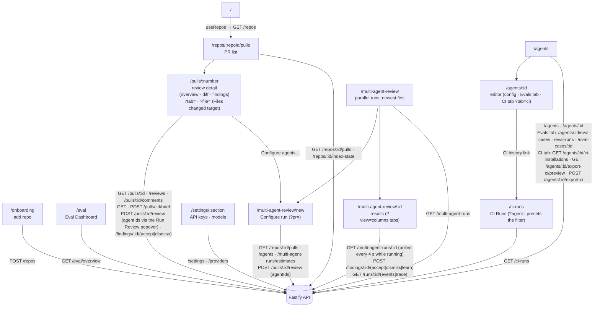

# `@devdigest/web` — the studio (Next.js 15)

The DevDigest UI: import repos, browse pull requests, run and read AI reviews,
and author agents. App Router + React Server/Client components, data via
**TanStack Query** hooks over the Fastify API. (This is the starter surface;
course lessons add the Skills, Memory, Eval, Blast/Brief, multi-agent, CI, and
dashboard screens.)

- **Stack:** Next.js 15 (App Router), React 19, TanStack Query, `next-intl`
  (messages in `messages/<locale>/*.json`), `recharts`, `mermaid`,
  `react-markdown`. UI primitives are vendored under `src/vendor/ui`
  (`@devdigest/ui`) and shared Zod contracts under `src/vendor/shared`
  (`@devdigest/shared`).
- **API base:** `NEXT_PUBLIC_API_BASE` (default `http://localhost:3001`), used by
  `src/lib/api.ts`. Every data hook lives in `src/lib/hooks/*`.
- **Run:** `pnpm dev` (`:3000`). **Test:** `pnpm test` (vitest + jsdom, fetch
  mocked — no API needed). **Typecheck:** `pnpm typecheck`.

## UI route map

Routes (`src/app/**/page.tsx`) and the API surface each leans on (via
`src/lib/hooks/*` → `src/lib/api.ts`):

On the PR detail route, the Overview tab opens with the **PR Brief** section
(`OverviewTab/_components/PrBriefSection`): `usePrBrief` reads the stored brief
(`GET /pulls/:id/brief`) and `useGeneratePrBrief` generates or regenerates it
(`POST /pulls/:id/brief`), both in `src/lib/hooks/brief.ts`. A Review focus item on a
changed file calls `openFile` in `page.tsx`, which writes `?tab=diff&file=<path>` in one
`router.replace`; the Files changed tab expands and scrolls to that file, so a reload keeps
the target, and switching tabs drops `file`. Spec: `../docs/specs/pr-brief.md`.

**Multi-Agent Review (SPEC-06).** The PR header's *Run Review* button opens
`RunReviewPopover` (`src/app/repos/[repoId]/pulls/[number]/_components/RunReviewPopover`):
one checkbox per agent, the enabled ones (at most 6) pre-checked, and a launch that sends one
`POST /pulls/:id/review` with `agentIds` and opens `/multi-agent-review/<parent id>`. The
routes live in `src/app/multi-agent-review/` — the index (`page.tsx`), *Configure run*
(`new/page.tsx`, `?pr=` preselects a PR of the active repo, estimates from
`GET /multi-agent-runs/estimates`) and the results page (`[id]/page.tsx`, Columns | Tabs kept in
`?view=`, a live log only for `running` columns, and the *Where agents disagree* table). Hooks:
`src/lib/hooks/multi-agent.ts`; the 6-agent cap: `src/lib/multi-agent.ts`. The run trace drawer
and the finding card are shared with the PR route from `src/components/run-trace-drawer` and
`src/components/finding-card`. The sidebar has a GLOBAL section with one *Multi-Agent Review*
entry (`src/vendor/ui/nav.ts`). Spec: `../docs/specs/multi-agent-review.md`.

The agent editor's **CI tab** (`?tab=ci`, `app/agents/[id]/_components/AgentEditor/_components/CiTab`) lists the agent's CI installations, hosts the shared "Fail CI on" gate and opens the **Export to CI** wizard (target, preview and edit, configure, install as a PR or a zip). The **CI Runs** page (`/ci-runs`, sidebar entry `CI Runs`) lists the runs the server ingested from GitHub Actions; each load or Refresh triggers ingest, so there is no polling. Both go through `src/lib/hooks/ci.ts`. Spec: `../docs/specs/export-to-ci.md`.

Cross-cutting chrome lives in `src/components/app-shell` (nav, breadcrumbs,
`g`-then-key shortcuts). Pages are thin; feature logic sits in colocated
`_components/<Name>/` folders, each with its own `*.test.tsx`.

## Testing

Component/interaction tests (`*.test.tsx`) run under vitest + jsdom with `fetch`
mocked, so they need neither the API nor a browser. The real browser journeys
(client + API + seeded DB) are covered by the deterministic agent-browser suite
in [`../e2e`](../e2e/README.md) and the `e2e-web.yml` workflow. See
[`../TESTING.md`](../TESTING.md).
