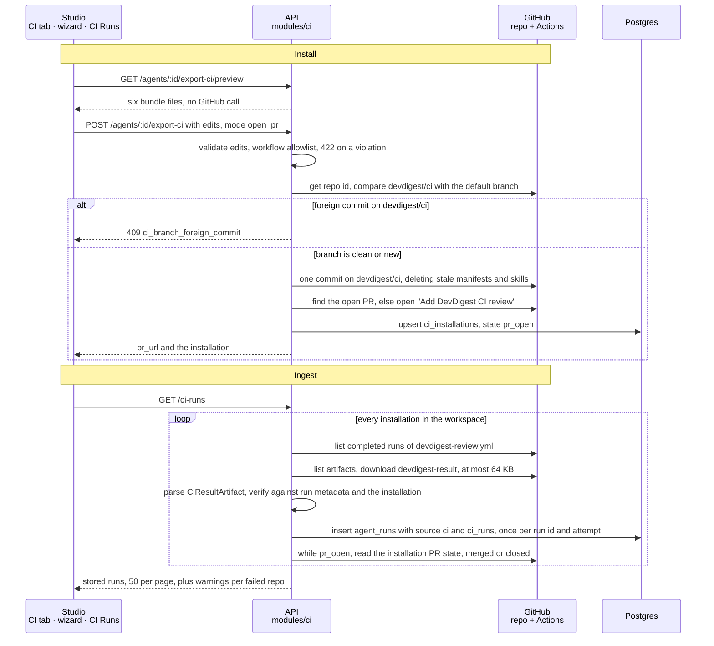

# Spec: Export to CI

Spec ID: SPEC-05
Status: implemented
Supersedes: —
Introduced in: L07

## Problem & user

A repo owner who has tuned a review agent in the studio (prompt, skills, CI gate) can only run it by hand, one PR at a time, from the studio. Their teammates' PRs get no review unless someone opens DevDigest and clicks Run. The CI runner exists (L07) but nothing produces the files a target repo needs to run it, nothing opens the PR that installs them, and the results never come back to DevDigest. So there is no record of what the agent found in CI, what it cost, or whether it blocked a merge.

## Goals / Non-goals

**Goals**
- A repo owner can install a studio agent into the GitHub Actions of an imported repo with one reviewed PR on a `devdigest/ci` branch, and never by a direct write to the default branch.
- The installed workflow reviews same-repo PRs with the least privilege that works: no PR code runs, secrets stay in GitHub, fork PRs are skipped.
- Every CI review result comes back to DevDigest through a channel the server verifies itself. It is visible on CI Runs and in the agent's CI tab with repository, PR, verdict, findings, cost, duration and a link to the job.
- The agent's "Fail CI on" gate can block merges once the repo owner makes the check required.

**Non-goals**
- CircleCI, Jenkins and Generic CLI generators. Their target cards stay hidden until a generator exists.
- A published `devdigest/review-action` marketplace action. The workflow runs the bundled runner committed to the repo.
- A push-based ingest endpoint, GitHub OIDC, a GitHub App, or a background poller. Ingest is a pull through the GitHub API on page load and on Refresh.
- Checking whether Actions secrets exist. The Actions secrets API is never called.
- Reviewing fork PRs, and any use of `pull_request_target`.
- Reviewing changes to `.github/workflows/**` and `.devdigest/**`. The runner strips them from the diff to avoid GitHub's 422 on the bundle (`agent-runner/src/diff.ts:7`). Tampering with those paths is left to the repo's branch protection and CODEOWNERS.
- Making the runner use `.devdigest/memory.jsonl`. The file ships, but the runner does not read it in this spec.
- Persisting files edited in the wizard's Preview step.
- Any change to the PR feed or to the multi-agent review service. A CI run linked to an imported PR is still counted in that PR's feed COST by the existing code.
- Configuring branch protection or rulesets in the target repo. The repo owner does that by hand.
- Several agents installed in one repo. A repo holds the CI installation of at most one agent, because the runner accepts exactly one manifest (AC-138).

## User stories

- US-1: As a repo owner in the studio, I want to export an agent to an imported repo's GitHub Actions as a PR, so that every same-repo PR gets that agent's review without me opening the studio.
- US-2: As a repo owner, I want to preview and adjust the generated workflow before anything is pushed, so that I can review permissions, triggers and secret handling first.
- US-3: As a repo owner, I want to download the files as a zip instead, so that I can add them by hand where DevDigest has no write access.
- US-4: As a reviewer in the studio, I want CI review runs listed with repo, PR, agent, verdict, findings, cost, duration and a job link, so that I can see what the agent did in CI.
- US-5: As a repo owner, I want to set "Fail CI on" for the agent and see which installations are behind, so that the merge gate in each repo matches the agent's current policy.
- US-6: As an operator running the server, I want CI results accepted only after the server has checked them against GitHub's own run data, so that a forged or mismatched artifact cannot create a run record.

## Flow

The install and ingest paths of the shipped feature. Anchors: `server/src/modules/ci/service.ts:80` (`preview`), `:93` (`export`), `:124` (`listRuns`); `server/src/modules/ci/ingest.ts:50` (`refresh`), `:70` (`refreshOne`), `:111` (`ingestRun`).

## Acceptance criteria (EARS)

### Contract (`@devdigest/shared`, both copies)

- [x] AC-1 The `CiResultArtifact` schema shall accept the optional fields `repository`, `repository_id`, `head_sha`, `verdict`, `blockers`, `run_id`, `run_attempt`, `installation_id` and `model`, and an artifact that omits all of them shall still validate. — `server/src/vendor/shared/contracts/eval-ci.ts:293` (`CiResultArtifact`) · test: `server/test/contracts.test.ts:477` ("artifact without identity fields parses; with all fields parses; unknown keys are stripped")
- [x] AC-2 The `CiResultArtifact` schema shall define no field meant to carry a credential, API key or token value. — `server/src/vendor/shared/contracts/eval-ci.ts:293` (`CiResultArtifact`) · test: `server/test/contracts.test.ts:477` ("artifact without identity fields parses; with all fields parses; unknown keys are stripped")
- [x] AC-3 The `CiInstallation` schema shall expose the installation state as exactly one of `pr_open`, `active`, `pr_closed`. — `server/src/vendor/shared/contracts/eval-ci.ts:211` (`CiInstallationState`), `server/src/vendor/shared/contracts/eval-ci.ts:218` (`CiInstallation`) · test: `server/test/ci.it.test.ts:1143` ("returns repo, target, state, versions, and the latest stored run or null (AC-71)")
- [x] AC-4 The `CiInstallation` schema shall expose the installed agent version, the runner version, the PR URL and whether the installation is behind the agent's current version. — `server/src/vendor/shared/contracts/eval-ci.ts:218` (`CiInstallation`), `server/src/vendor/shared/contracts/eval-ci.ts:228` (`behind`) · test: `server/test/ci.it.test.ts:1143` ("returns repo, target, state, versions, and the latest stored run or null (AC-71)"), `server/test/ci.it.test.ts:1168` ("flags an installation behind only when the agent version is newer than the installed one (AC-72)")
- [x] AC-5 The `CiRun` schema shall expose repository, PR number, agent name, verdict, findings count, blocker count, cost (nullable), duration, head SHA, job URL and status. — `server/src/vendor/shared/contracts/eval-ci.ts:251` (`CiRun`) · test: `server/test/ci.it.test.ts:753` ("stores a verified artifact as a source=ci agent run with the run metadata, and reports the installation agent (AC-48, AC-49, AC-52, AC-53, AC-70)")
- [x] AC-6 `CiExportInput` shall accept `gha` as the only `target` value. — `server/src/vendor/shared/contracts/eval-ci.ts:176` (`CiExportInput.target`) · test: `server/test/contracts.test.ts:486` ("CiExportInput rejects other targets and bad triggers; applies defaults")
- [x] AC-7 Each schema change in this spec shall be identical in the server copy and the client copy of `@devdigest/shared`. — `server/src/vendor/shared/contracts/eval-ci.ts:293` (`CiResultArtifact`), `client/src/vendor/shared/contracts/eval-ci.ts:293` (`CiResultArtifact`) · untested

### Server — CI bundle generation

- [x] AC-8 WHEN the studio requests a CI bundle preview for an agent and an imported repo, the API shall return exactly these files: `.devdigest/agents/<agent-slug>.yaml`, one `.devdigest/skills/<skill-slug>.md` per enabled skill attached to the agent, `.devdigest/memory.jsonl`, `.github/workflows/devdigest-review.yml`, `.devdigest/runner/index.js` and `.devdigest/runner/package.json` (`{"type": "module"}`, because the bundle is an ES module). — `server/src/modules/ci/helpers.ts:141` (`buildBundle`), `server/src/modules/ci/service.ts:80` (`CiService.preview`) · test: `server/test/ci.it.test.ts:249` ("returns exactly the six bundle files with editable flags on workflow and skills only (AC-8, AC-12, AC-13)"), `server/test/ci-service.test.ts:36` ("returns the six generated paths, enabled skills only, with editable flags")
- [x] AC-9 The generated agent manifest shall pass `AgentManifest` validation and carry the agent's current name, provider, model, system prompt, skill slugs, strategy and `ci_fail_on`. — `server/src/modules/ci/helpers.ts:81` (`buildManifestYaml`) · test: `server/test/ci-helpers.test.ts:200` ("manifest round-trips through AgentManifest")
- [x] AC-10 The generated `.devdigest/memory.jsonl` shall contain one JSON line per workspace memory entry whose scope is the target repo or global, and each line shall hold only that entry's content and kind. — `server/src/modules/ci/repository.ts:49` (`memoryForRepo`), `server/src/modules/ci/helpers.ts:95` (`buildMemoryJsonl`) · test: `server/test/ci.it.test.ts:281` ("writes repo + global memory as {content, kind} lines and excludes other repos (AC-10)")
- [x] AC-11 IF the workspace has no memory entry scoped to the target repo or global, THEN the generated `.devdigest/memory.jsonl` shall be an empty file (0 bytes). — `server/src/modules/ci/helpers.ts:95` (`buildMemoryJsonl`) · test: `server/test/ci.it.test.ts:303` ("writes a 0-byte memory file when the workspace has no applicable memory (AC-11)"), `server/test/ci-helpers.test.ts:206` ("empty memory is an empty file")
- [x] AC-12 The bundle preview shall mark the workflow and every skill file as editable. — `server/src/modules/ci/helpers.ts:149` (`buildBundle (workflow)`), `server/src/modules/ci/helpers.ts:158` (`buildBundle (skills)`) · test: `server/test/ci.it.test.ts:249` ("returns exactly the six bundle files with editable flags on workflow and skills only (AC-8, AC-12, AC-13)")
- [x] AC-13 The bundle preview shall mark the agent manifest, `.devdigest/memory.jsonl`, the runner bundle and `.devdigest/runner/package.json` as not editable. — `server/src/modules/ci/helpers.ts:153` (`buildBundle (manifest)`), `server/src/modules/ci/helpers.ts:160` (`buildBundle (memory)`), `server/src/modules/ci/helpers.ts:161` (`buildBundle (runner)`), `server/src/modules/ci/helpers.ts:162` (`buildBundle (runner package.json)`) · test: `server/test/ci.it.test.ts:249` ("returns exactly the six bundle files with editable flags on workflow and skills only (AC-8, AC-12, AC-13)")
- [x] AC-14 IF the prebuilt runner bundle is missing on the server, THEN the API shall reject the preview and the install with an error message telling the operator to build the agent-runner package. — `server/src/modules/ci/service.ts:147` (`CiService.prepare, BUILD_HINT`), `server/src/adapters/runner-bundle/file.ts:29` (`FileRunnerBundleSource.read`) · test: `server/test/ci.it.test.ts:347` ("fails with a message pointing at the agent-runner build when the bundle is missing (AC-14)"), `server/test/ci-service.test.ts:47` ("explains how to build a missing bundle")
- [x] AC-15 The API shall never build the runner bundle as part of a preview or an install request. — `server/src/adapters/runner-bundle/file.ts:21` (`FileRunnerBundleSource, read-only`) · untested
- [x] AC-16 IF an agent's skill slug would produce a path containing `/`, `\` or `..` under `.devdigest/skills/`, THEN the API shall reject the preview and the install with a 422 error naming the skill. — `server/src/modules/ci/helpers.ts:55` (`assertSafeSlugs`) · test: `server/test/ci.it.test.ts:363` ("rejects a skill whose slug contains ".." with 422 naming the skill (AC-16)")
- [x] AC-17 IF the requested repo is not imported into the caller's workspace, THEN the API shall reject the preview and the export with 404 and make no GitHub call. — `server/src/modules/ci/service.ts:144` (`CiService.prepare`) · test: `server/test/ci.it.test.ts:328` ("answers 404 with zero GitHub calls for a repo that is not imported (AC-17)"), `server/test/ci.it.test.ts:646` ("answers 404 with zero GitHub calls for a repo that is not imported (AC-17)")
- [x] AC-18 WHEN `POST /agents/:id/export-ci` receives a `target` other than `gha`, the API shall reject the request with a 422 validation error. — `server/src/vendor/shared/contracts/eval-ci.ts:176` (`CiExportInput.target`), `server/src/modules/ci/routes.ts:49` (`POST /agents/:id/export-ci body schema`) · test: `server/test/ci.it.test.ts:618` ("target other than gha (AC-18) — open_pr")
- [x] AC-133 The API shall derive the agent slug and every skill slug from the name by lowercasing it, applying Unicode NFKD normalisation, replacing every run of characters outside `[a-z0-9._-]` with a single `-`, and trimming leading and trailing `-`. — `server/src/modules/ci/helpers.ts:38` (`slugify`) · test: `server/test/ci-helpers.test.ts:49` ("slugifies per AC-133")
- [x] AC-134 IF two enabled skills attached to the agent derive the same slug, THEN the API shall reject the preview and the install with a 422 error naming both skills, and IF the agent or an enabled skill derives an empty slug, THEN it shall reject them with a 422 error naming that agent or skill. — `server/src/modules/ci/helpers.ts:55` (`assertSafeSlugs`) · test: `server/test/ci.it.test.ts:380` ("rejects two enabled skills with the same slug, naming both (AC-134)"), `server/test/ci.it.test.ts:394` ("rejects a name that slugifies to empty with 422 (AC-134)")

### Server — generated workflow

- [x] AC-19 The generated workflow, including the one an install regenerates when the workflow was not edited, shall trigger only on the `pull_request` event, with exactly the activity types selected in the wizard's Configure step. — `server/src/modules/ci/helpers.ts:107` (`buildWorkflowYaml`), `server/src/modules/ci/service.ts:104` (`CiService.export`) · test: `server/test/ci-helpers.test.ts:65` ("has only pull_request with the given types")
- [x] AC-20 IF an export request selects no trigger type, or a type other than `opened`, `synchronize` or `reopened`, THEN the API shall reject it with 422. — `server/src/vendor/shared/contracts/eval-ci.ts:180` (`CiExportInput.triggers`) · test: `server/test/ci.it.test.ts:618` ("no trigger type (AC-20) — open_pr")
- [x] AC-21 The generated workflow shall declare a top-level `permissions` block granting exactly `contents: read` and `pull-requests: write`, so every other permission is `none`. — `server/src/modules/ci/helpers.ts:108` (`buildWorkflowYaml`) · test: `server/test/ci-helpers.test.ts:68` ("has the two least-privilege grants")
- [x] AC-22 The generated workflow shall check out the PR's base commit and never the PR's head commit or merge ref. — `server/src/modules/ci/helpers.ts:116` (`buildWorkflowYaml`), `server/src/modules/ci/constants.ts:33` (`BASE_SHA_REF`) · test: `server/test/ci-helpers.test.ts:76` ("checks out the base sha, uploads always, sets installation id and post-as")
- [x] AC-23 The generated workflow shall run the review job only when the PR head repository's full name equals the workflow repository's full name. — `server/src/modules/ci/helpers.ts:112` (`buildWorkflowYaml`), `server/src/modules/ci/constants.ts:31` (`SAME_REPO_GUARD`) · test: `server/test/ci-helpers.test.ts:64` ("passes its own validator")
- [x] AC-24 The generated workflow shall not use the `pull_request_target` event. — `server/src/modules/ci/helpers.ts:107` (`buildWorkflowYaml`) · test: `server/test/ci-helpers.test.ts:65` ("has only pull_request with the given types")
- [x] AC-25 Every `uses:` reference in the generated workflow shall be pinned to a 40-character hexadecimal commit SHA. — `server/src/modules/ci/constants.ts:36` (`ACTION_CHECKOUT`) · test: `server/test/ci-helpers.test.ts:71` ("pins every action and keeps ${{ out of run steps")
- [x] AC-26 The generated workflow shall run the review as `node .devdigest/runner/index.js` and shall reference no `devdigest/review-action`. — `server/src/modules/ci/helpers.ts:121` (`buildWorkflowYaml`), `server/src/modules/ci/constants.ts:15` (`RUNNER_COMMAND`) · untested
- [x] AC-27 The generated workflow shall pass `OPENROUTER_API_KEY` from `secrets.OPENROUTER_API_KEY` and `GITHUB_TOKEN` from the job's own token, only in the environment of the runner step. — `server/src/modules/ci/helpers.ts:122` (`buildWorkflowYaml (runner step env)`) · untested
- [x] AC-28 The generated workflow, including the one an install regenerates when the workflow was not edited, shall set `DEVDIGEST_POST_AS` in the runner step to the publish mode chosen in the wizard's Configure step: `github_review`, `pr_comment` or `none`. — `server/src/modules/ci/helpers.ts:125` (`buildWorkflowYaml`), `server/src/modules/ci/service.ts:104` (`CiService.export`) · test: `server/test/ci-helpers.test.ts:76` ("checks out the base sha, uploads always, sets installation id and post-as")
- [x] AC-29 The generated workflow shall pass the installation id to the runner step. — `server/src/modules/ci/helpers.ts:126` (`buildWorkflowYaml`), `server/src/modules/ci/helpers.ts:167` (`installationIdFor`) · test: `server/test/ci-helpers.test.ts:76` ("checks out the base sha, uploads always, sets installation id and post-as"), `server/test/ci-helpers.test.ts:217` ("installationIdFor is deterministic and uuid-shaped")
- [x] AC-30 The generated workflow shall not interpolate any PR-controlled event field (title, body, head ref, branch name, comment text) into a `run:` script. — `server/src/modules/ci/helpers.ts:121` (`buildWorkflowYaml`) · test: `server/test/ci-helpers.test.ts:71` ("pins every action and keeps ${{ out of run steps")
- [x] AC-31 The generated workflow shall upload `devdigest-result.json` as a workflow artifact whenever the runner wrote one, including when the runner exited non-zero. — `server/src/modules/ci/helpers.ts:130` (`buildWorkflowYaml`) · test: `server/test/ci-helpers.test.ts:76` ("checks out the base sha, uploads always, sets installation id and post-as")

### Server — edited files on install

- [x] AC-32 IF the edited workflow submitted with an install request is not valid YAML, THEN the API shall reject the install with 422 and make no GitHub call. — `server/src/modules/ci/domain.ts:212` (`parseStrict`) · test: `server/test/ci.it.test.ts:618` ("workflow that is not valid YAML (AC-32) — open_pr")
- [x] AC-33 IF the edited workflow has no top-level `permissions` block, or grants any permission other than `contents: read` and `pull-requests: write`, THEN the API shall reject the install with 422 and make no GitHub call. — `server/src/modules/ci/domain.ts:240` (`validateEditedWorkflow`) · test: `server/test/ci.it.test.ts:618` ("workflow without a permissions block (AC-33) — open_pr")
- [x] AC-34 IF the edited workflow uses the `pull_request_target` event, THEN the API shall reject the install with 422 and make no GitHub call. — `server/src/modules/ci/domain.ts:246` (`validateEditedWorkflow`) · test: `server/test/ci.it.test.ts:618` ("workflow using pull_request_target (AC-34) — open_pr")
- [x] AC-35 IF an install request carries contents for the agent manifest, `.devdigest/memory.jsonl`, the runner bundle, or a path that is not in the generated file set, THEN the API shall reject the install with 422 and make no GitHub call. — `server/src/modules/ci/domain.ts:336` (`validateEdits`), `server/src/modules/ci/service.ts:176` (`CiService.applyEdits`) · test: `server/test/ci.it.test.ts:618` ("edit for the agent manifest (AC-35) — open_pr")
- [x] AC-131 IF the edited workflow does not check out the PR's base commit, drops the same-repo guard of AC-23, has a `uses:` reference not pinned to a 40-character hexadecimal commit SHA, or has no step that runs `node .devdigest/runner/index.js`, THEN the API shall reject the install with 422 and make no GitHub call. — `server/src/modules/ci/domain.ts:265` (`validateEditedWorkflow (guard)`), `server/src/modules/ci/domain.ts:274` (`validateEditedWorkflow (SHA pin)`), `server/src/modules/ci/domain.ts:278` (`validateEditedWorkflow (base checkout)`), `server/src/modules/ci/domain.ts:288` (`validateEditedWorkflow (runner step)`) · test: `server/test/ci.it.test.ts:618` ("workflow without the base checkout (AC-131) — open_pr"), `server/test/ci-helpers.test.ts:134` ("rejects %s")
- [x] AC-135 WHEN an install request carries an edited workflow, the API shall set that workflow's `on.pull_request.types` to exactly the trigger types chosen in the wizard's Configure step before it commits or zips the workflow. — `server/src/modules/ci/domain.ts:312` (`patchWorkflow`), `server/src/modules/ci/service.ts:183` (`CiService.applyEdits`) · test: `server/test/ci.it.test.ts:511` ("applies an edited skill and re-enforces the Configure choices on an edited workflow (AC-37, AC-135..137)"), `server/test/ci-helpers.test.ts:158` ("rewrites triggers and post-as and preserves comments and other keys")
- [x] AC-136 WHEN an install request carries an edited workflow, the API shall set `DEVDIGEST_POST_AS` in the environment of the step that runs `node .devdigest/runner/index.js` to the publish mode chosen in the wizard's Configure step before it commits or zips the workflow. — `server/src/modules/ci/domain.ts:318` (`patchWorkflow`) · test: `server/test/ci.it.test.ts:511` ("applies an edited skill and re-enforces the Configure choices on an edited workflow (AC-37, AC-135..137)"), `server/test/ci-service.test.ts:112` ("re-applies Configure choices onto an edited workflow"), `server/test/ci-helpers.test.ts:158` ("rewrites triggers and post-as and preserves comments and other keys")
- [x] AC-137 WHEN the API applies AC-135 and AC-136 to an edited workflow, it shall keep every other key and value of that workflow as the user submitted it. — `server/src/modules/ci/domain.ts:306` (`patchWorkflow`) · test: `server/test/ci-helpers.test.ts:158` ("rewrites triggers and post-as and preserves comments and other keys"), `server/test/ci-helpers.test.ts:169` ("overwrites a stale installation id on the runner step only")
- [x] AC-36 WHEN the studio requests a preview after an install that carried edits, the API shall return the freshly generated files, not the edited ones. — `server/src/modules/ci/service.ts:80` (`CiService.preview`) · untested

### Server — install as a PR

- [x] AC-37 WHEN an install request asks to open a PR, the API shall commit every bundle file, with accepted edits applied and the Configure choices enforced by AC-135 and AC-136, as one commit on the branch `devdigest/ci` of the target repo. — `server/src/modules/ci/service.ts:221` (`CiService.openPr`) · test: `server/test/ci.it.test.ts:417` ("commits the whole bundle as one commit on devdigest/ci, opens the PR and records one pr_open installation (AC-37..41, AC-44)"), `server/test/ci.it.test.ts:511` ("applies an edited skill and re-enforces the Configure choices on an edited workflow (AC-37, AC-135..137)")
- [x] AC-38 The API shall never create a commit on, or move, any branch of the target repo other than `devdigest/ci`. — `server/src/modules/ci/service.ts:222` (`CiService.openPr`), `server/src/modules/ci/constants.ts:2` (`CI_BRANCH`) · untested
- [x] AC-39 WHEN `devdigest/ci` does not exist in the target repo, the API shall create it from the head of the repo's default branch as recorded in the workspace. — `server/src/modules/ci/service.ts:223` (`CiService.openPr`), `server/src/adapters/github/octokit.ts:314` (`commitFiles`) · test: `server/test/ci.it.test.ts:417` ("commits the whole bundle as one commit on devdigest/ci, opens the PR and records one pr_open installation (AC-37..41, AC-44)")
- [x] AC-40 WHEN an open PR with head `devdigest/ci` already exists, the API shall add the new commit to that PR and return its URL. — `server/src/modules/ci/service.ts:230` (`CiService.openPr`) · test: `server/test/ci.it.test.ts:456` ("updates the same installation and reuses the open PR on a repeat install (AC-40, AC-45)")
- [x] AC-41 WHEN no open PR with head `devdigest/ci` exists, the API shall open a PR titled "Add DevDigest CI review" from `devdigest/ci` into the repo's default branch and return its URL. — `server/src/modules/ci/service.ts:231` (`CiService.openPr`), `server/src/modules/ci/constants.ts:24` (`PR_TITLE`) · test: `server/test/ci.it.test.ts:417` ("commits the whole bundle as one commit on devdigest/ci, opens the PR and records one pr_open installation (AC-37..41, AC-44)")
- [x] AC-42 IF `devdigest/ci` contains a commit that DevDigest did not create, THEN the API shall refuse the install with 409 and leave the branch unchanged. — `server/src/modules/ci/service.ts:207` (`CiService.openPr`) · test: `server/test/ci.it.test.ts:477` ("refuses with 409 when devdigest/ci holds a commit DevDigest did not write, leaving the branch alone (AC-42)"), `server/test/ci-service.test.ts:123` ("409 and no commit when devdigest/ci has a foreign commit")
- [x] AC-43 IF GitHub answers 403 or 404 to any write of the install, THEN the API shall return an error with the message "token lacks write access to <owner/name>" and create no installation record. — `server/src/modules/ci/service.ts:265` (`CiService.mapGitHubError`) · test: `server/test/ci.it.test.ts:494` ("maps a GitHub 403 on the write to "token lacks write access" and records no installation (AC-43)"), `server/test/ci-service.test.ts:131` ("maps GitHub 403 to a clear error and stores nothing")
- [x] AC-44 WHEN the install opens or updates a PR, the API shall record an installation for that agent and repo with state `pr_open` (or keeps state `active` if the installation already was `active`), the agent version, the runner version, the GitHub numeric repository id and the PR URL. — `server/src/modules/ci/service.ts:240` (`CiService.openPr`), `server/src/modules/ci/repository.ts:79` (`CiRepository.upsertInstallation`), `server/src/modules/ci/repository.ts:104` (`CASE keeps active`) · test: `server/test/ci.it.test.ts:417` ("commits the whole bundle as one commit on devdigest/ci, opens the PR and records one pr_open installation (AC-37..41, AC-44)")
- [x] AC-45 WHEN an install repeats for an agent and repo that already have an installation, the API shall update that installation and not create a second one. — `server/src/modules/ci/repository.ts:99` (`CiRepository.upsertInstallation`), `server/src/db/schema/ci.ts:43` (`ci_installations_workspace_repo_uq`) · test: `server/test/ci.it.test.ts:456` ("updates the same installation and reuses the open PR on a repeat install (AC-40, AC-45)")
- [x] AC-138 IF an install request, as a PR or as a zip, targets a repo that already has an installation of a different agent, THEN the API shall refuse it with 409 and make no GitHub write. — `server/src/modules/ci/service.ts:96` (`CiService.export`) · test: `server/test/ci.it.test.ts:567` ("refuses with 409 and makes no GitHub write when another agent already owns the repo (AC-138)"), `server/test/ci.it.test.ts:703` ("refuses with 409 and no GitHub call when another agent owns the repo (AC-138)"), `server/test/ci-service.test.ts:91` ("another agent installation answers 409 in both modes with no GitHub call")
- [x] AC-139 WHEN a PR install commits the bundle, the commit shall delete every `.devdigest/agents/*.yaml` and `.devdigest/skills/*.md` file of the branch's parent tree that is not in the generated file set, so the target repo holds exactly one agent manifest. — `server/src/modules/ci/service.ts:217` (`CiService.openPr`), `server/src/modules/ci/domain.ts:366` (`stalePaths`), `server/src/adapters/github/octokit.ts:354` (`commitFiles (delete entries)`) · test: `server/test/ci.it.test.ts:540` ("deletes the previous manifest and removed skills in the same commit, never other paths (AC-37, AC-139)"), `server/test/ci-service.test.ts:140` ("deletes exactly the stale manifest on a renamed re-install")

### Server — install as a zip

- [x] AC-46 WHEN an install request asks for a zip, the API shall return a zip archive holding exactly the bundle files at their repo paths, with accepted edits applied and the Configure choices enforced by AC-135 and AC-136. — `server/src/modules/ci/service.ts:107` (`CiService.export (zip)`), `server/src/modules/ci/helpers.ts:194` (`zipFiles`) · test: `server/test/ci.it.test.ts:676` ("returns a zip holding exactly the bundle files with edits applied, and writes nothing (AC-46, AC-47)")
- [x] AC-47 WHEN an install request asks for a zip, the API shall make no GitHub write and create or change no installation record. — `server/src/modules/ci/service.ts:107` (`CiService.export (zip)`) · test: `server/test/ci.it.test.ts:676` ("returns a zip holding exactly the bundle files with edits applied, and writes nothing (AC-46, AC-47)"), `server/test/ci.it.test.ts:719` ("lets the owning agent export a zip of its own installation without changing the row (AC-47)"), `server/test/ci-service.test.ts:81` ("zip mode makes no GitHub call and no store write")

### Server — CI run ingest

- [x] AC-48 WHEN the CI runs list is requested or refreshed, the server shall ask GitHub, for every installation in the workspace, for completed runs of the DevDigest workflow that are not yet ingested. — `server/src/modules/ci/service.ts:125` (`CiService.listRuns`), `server/src/modules/ci/ingest.ts:50` (`CiIngest.refresh`) · test: `server/test/ci.it.test.ts:753` ("stores a verified artifact as a source=ci agent run with the run metadata, and reports the installation agent (AC-48, AC-49, AC-52, AC-53, AC-70)")
- [x] AC-49 WHEN a completed run has a `devdigest-result.json` artifact, the server shall download it through the GitHub API with the server's own GitHub token. — `server/src/modules/ci/ingest.ts:148` (`CiIngest.ingestRun`), `server/src/adapters/github/octokit.ts:491` (`downloadArtifact`), `server/src/platform/container.ts:219` (`ciGithub`) · test: `server/test/ci.it.test.ts:753` ("stores a verified artifact as a source=ci agent run with the run metadata, and reports the installation agent (AC-48, AC-49, AC-52, AC-53, AC-70)")
- [x] AC-50 IF a downloaded artifact fails `CiResultArtifact` validation, THEN the server shall write no run record for it and log the GitHub run id and the reason. — `server/src/modules/ci/ingest.ts:161` (`CiIngest.ingestRun`), `server/src/modules/ci/ingest.ts:206` (`CiIngest.reject`) · test: `server/test/ci.it.test.ts:972` ("fails the CiResultArtifact schema (AC-50)"), `server/test/ci.it.test.ts:972` ("is not JSON (AC-50)")
- [x] AC-132 IF a `devdigest-result.json` artifact is larger than 64 KB (65,536 bytes), THEN the server shall reject it without parsing it, write no run record for it, and log it like AC-50. — `server/src/modules/ci/ingest.ts:146` (`CiIngest.ingestRun`), `server/src/modules/ci/helpers.ts:279` (`readSingleZipEntry`), `server/src/modules/ci/helpers.ts:292` (`readSingleZipEntry`), `server/src/modules/ci/constants.ts:20` (`MAX_ARTIFACT_BYTES`) · test: `server/test/ci.it.test.ts:972` ("is declared larger than 64 KB (AC-132)"), `server/test/ci-helpers.test.ts:238` ("enforces the limit while inflating even if the header lies")
- [x] AC-51 IF the artifact's `repository`, `repository_id`, `head_sha`, `pr_number` or `installation_id` is missing or differs from GitHub's metadata for that workflow run, or from the installation's repository, GitHub repository id and installation id, THEN the server shall write no run record for it and log the GitHub run id and the mismatched field. — `server/src/modules/ci/domain.ts:393` (`verifyArtifact`), `server/src/modules/ci/ingest.ts:167` (`CiIngest.ingestRun`) · test: `server/test/ci.it.test.ts:972` ("repository differs (AC-51)"), `server/test/ci-helpers.test.ts:256` ("requires the artifact to match the installation repo (AC-51)")
- [x] AC-52 WHEN an artifact passes validation and verification, the server shall write one agent run with source `ci` for the installation's agent, holding the findings count, blocker count, cost, duration and model. — `server/src/modules/ci/repository.ts:143` (`CiRepository.insertCiRun`) · test: `server/test/ci.it.test.ts:753` ("stores a verified artifact as a source=ci agent run with the run metadata, and reports the installation agent (AC-48, AC-49, AC-52, AC-53, AC-70)")
- [x] AC-53 WHEN the server writes a CI agent run, it shall also store the repository, PR number, head SHA, job URL, GitHub run id, run attempt and artifact id, using the workflow run's `html_url` from GitHub as the job URL. — `server/src/modules/ci/ingest.ts:126` (`CiIngest.ingestRun`), `server/src/modules/ci/repository.ts:143` (`CiRepository.insertCiRun`) · test: `server/test/ci.it.test.ts:753` ("stores a verified artifact as a source=ci agent run with the run metadata, and reports the installation agent (AC-48, AC-49, AC-52, AC-53, AC-70)")
- [x] AC-54 Ingesting the same GitHub run id and run attempt for the same installation more than once shall leave exactly one run record. — `server/src/db/schema/ci.ts:77` (`ci_runs_installation_run_attempt_uq`), `server/src/modules/ci/repository.ts:178` (`CiRepository.insertCiRun`) · test: `server/test/ci.it.test.ts:789` ("is idempotent: two refreshes leave exactly one run record (AC-54)"), `server/test/ci-ingest.test.ts:123` ("is idempotent across refreshes and honours attempts")
- [x] AC-55 WHEN the PR of an ingested run is imported in the workspace, the server shall link the agent run to that PR. — `server/src/modules/ci/repository.ts:251` (`CiRepository.findPullId`) · test: `server/test/ci.it.test.ts:805` ("links the run to an imported PR and leaves an unknown PR unlinked, importing nothing (AC-55, AC-56, AC-57)")
- [x] AC-56 WHEN the PR of an ingested run is not imported in the workspace, the server shall store the run with no PR link. — `server/src/modules/ci/repository.ts:251` (`CiRepository.findPullId`) · test: `server/test/ci.it.test.ts:805` ("links the run to an imported PR and leaves an unknown PR unlinked, importing nothing (AC-55, AC-56, AC-57)")
- [x] AC-57 Ingest shall never import a repository or a PR into the workspace. — `server/src/modules/ci/repository.ts:143` (`CiRepository.insertCiRun`) · test: `server/test/ci.it.test.ts:805` ("links the run to an imported PR and leaves an unknown PR unlinked, importing nothing (AC-55, AC-56, AC-57)")
- [x] AC-58 WHEN an artifact reports a null cost, the server shall store the run's cost as null, never as 0. — `server/src/modules/ci/ingest.ts:181` (`CiIngest.ingestRun`) · test: `server/test/ci.it.test.ts:868` ("stores a null cost as null, never 0 (AC-58)")
- [x] AC-59 WHEN a verified artifact reports zero findings, the server shall store the run with status `no_findings`. — `server/src/modules/ci/domain.ts:354` (`statusFor`) · test: `server/test/ci.it.test.ts:882` ("maps zero findings to no_findings and one or more to succeeded even when the job failed (AC-59, AC-60)")
- [x] AC-60 WHEN a verified artifact reports one or more findings, the server shall store the run with status `succeeded` and the artifact's blocker count, whether the job concluded success or failure. — `server/src/modules/ci/domain.ts:354` (`statusFor`), `server/src/modules/ci/ingest.ts:183` (`CiIngest.ingestRun`) · test: `server/test/ci.it.test.ts:882` ("maps zero findings to no_findings and one or more to succeeded even when the job failed (AC-59, AC-60)"), `server/test/ci-ingest.test.ts:52` ("0 findings is no_findings; findings on a failed job are succeeded with blockers")
- [x] AC-61 IF a completed run of the DevDigest workflow that AC-140 and AC-141 do not exclude has no `devdigest-result.json` artifact, including a run that concluded `cancelled`, THEN the server shall store the run with status `failed`, its PR number, head SHA and job URL taken from GitHub's run metadata, and no findings count. — `server/src/modules/ci/ingest.ts:132` (`CiIngest.ingestRun`) · test: `server/test/ci.it.test.ts:904` ("stores a run without an artifact, including a cancelled one, as failed with GitHub metadata only (AC-61)"), `server/test/ci-ingest.test.ts:111` ("stores failed with GitHub metadata when there is no artifact (also cancelled)")
- [x] AC-140 IF a workflow run's head branch is `devdigest/ci`, THEN the server shall store nothing for it, so it counts for neither AC-61 nor AC-62. — `server/src/modules/ci/domain.ts:377` (`shouldIngest`), `server/src/modules/ci/ingest.ts:83` (`CiIngest.refreshOne`) · test: `server/test/ci.it.test.ts:922` ("stores nothing for a run on devdigest/ci and keeps the installation pr_open (AC-140)")
- [x] AC-141 IF a workflow run concluded `skipped`, THEN the server shall store nothing for it. — `server/src/modules/ci/domain.ts:377` (`shouldIngest`) · test: `server/test/ci.it.test.ts:936` ("stores nothing for a run that concluded skipped (AC-141)")
- [x] AC-62 WHEN the server stores the first run of an installation in state `pr_open`, it shall set that installation's state to `active`. — `server/src/modules/ci/ingest.ts:95` (`CiIngest.refreshOne`) · test: `server/test/ci.it.test.ts:991` ("moves pr_open to active when the first run is stored (AC-62)")
- [x] AC-63 WHEN a refresh finds an installation's PR merged, the server shall set that installation's state to `active`. — `server/src/modules/ci/ingest.ts:101` (`CiIngest.refreshOne`), `server/src/adapters/github/octokit.ts:506` (`getPullState`) · test: `server/test/ci.it.test.ts:1003` ("moves pr_open to active when the PR was merged (AC-63)")
- [x] AC-64 WHEN a refresh finds an installation's PR closed without merging and the installation has no ingested run, the server shall set its state to `pr_closed`. — `server/src/modules/ci/ingest.ts:103` (`CiIngest.refreshOne`) · test: `server/test/ci.it.test.ts:1014` ("moves pr_open to pr_closed when the PR was closed unmerged and no run was ingested (AC-64)"), `server/test/ci-ingest.test.ts:129` ("PR transitions: merged → active; closed with no runs → pr_closed; closed with a run stays active")
- [x] AC-65 IF a GitHub request during ingest fails for a repo (403, 404, rate limit or network error), THEN the CI runs list shall still return every run already stored, plus a warning naming that repo. — `server/src/modules/ci/ingest.ts:52` (`CiIngest.refresh`), `server/src/modules/ci/service.ts:125` (`CiService.listRuns`) · test: `server/test/ci.it.test.ts:1025` ("still returns stored runs plus a warning naming the repo when GitHub fails for it (AC-65)"), `server/test/ci-ingest.test.ts:140` ("a 403 for one repo yields a warning, not a throw")
- [x] AC-66 The server shall never call the GitHub Actions secrets API. — `server/src/adapters/github/octokit.ts:442` (`listWorkflowRuns`) · untested
- [x] AC-67 The server shall never log, store or return a value of `OPENROUTER_API_KEY` or `GITHUB_TOKEN`. — `server/src/modules/ci/ingest.ts:206` (`CiIngest.reject`), `server/src/modules/ci/service.ts:271` (`CiService.mapGitHubError`) · test: `server/test/ci.it.test.ts:1040` ("does not leak a token or an artifact body into a warning (AC-67)")

### Server — CI runs and installations read

- [x] AC-68 The CI runs list shall return the workspace's CI runs newest first, 50 per page. — `server/src/modules/ci/repository.ts:239` (`CiRepository.listCiRuns`), `server/src/modules/ci/constants.ts:27` (`RUNS_PAGE_SIZE`) · test: `server/test/ci.it.test.ts:1055` ("returns 50 per page newest first and flags the 51st on the next page (AC-68, NFR-2)")
- [x] AC-69 The CI runs list shall filter by time window (`7d` or `all`, defaulting to `7d`), agent, repository and status. — `server/src/vendor/shared/contracts/eval-ci.ts:269` (`CiRunsQuery`), `server/src/modules/ci/repository.ts:231` (`CiRepository.listCiRuns`) · test: `server/test/ci.it.test.ts:1081` ("defaults to the last 7 days and returns older runs with window=all (AC-69)"), `server/test/ci.it.test.ts:1106` ("filters by agent, repository and status (AC-69)")
- [x] AC-70 The CI runs list shall report each run's agent as the name of the installation's agent, never the artifact's `agent` string. — `server/src/modules/ci/repository.ts:214` (`CiRepository.listCiRuns`) · test: `server/test/ci.it.test.ts:753` ("stores a verified artifact as a source=ci agent run with the run metadata, and reports the installation agent (AC-48, AC-49, AC-52, AC-53, AC-70)")
- [x] AC-71 The installations list for an agent shall return, per installation, the repository, target `gha`, state, installed agent version, runner version, and the status and time of the latest stored run, or no run. — `server/src/modules/ci/repository.ts:270` (`CiRepository.selectInstallations`), `server/src/modules/ci/helpers.ts:323` (`toInstallationDto`) · test: `server/test/ci.it.test.ts:1143` ("returns repo, target, state, versions, and the latest stored run or null (AC-71)")
- [x] AC-72 WHERE the agent's current version is newer than an installation's installed agent version, the installations list shall report that installation as behind. — `server/src/modules/ci/domain.ts:358` (`isBehind`) · test: `server/test/ci.it.test.ts:1168` ("flags an installation behind only when the agent version is newer than the installed one (AC-72)")

### Boundaries

- [x] AC-73 This feature shall change neither the PR feed's behaviour or code, nor the multi-agent review service. — `server/src/modules/ci/repository.ts:143` (`CiRepository.insertCiRun (writes agent_runs and ci_runs only)`) · untested
- [x] AC-74 WHEN a CI run is linked to an imported PR, the PR feed's COST for that PR shall include the run's cost through the existing totals, with no code change to the PR feed. — `server/src/modules/pulls/repository.ts:194` (`PR feed cost totals (unchanged)`) · test: `server/test/ci.it.test.ts:842` ("adds a linked CI run's cost to the PR feed COST through the existing totals (AC-74)")

### Studio — CI tab

- [x] AC-75 The agent page shall show a CI tab, reachable by URL and by keyboard like the other agent tabs. — `client/src/app/agents/[id]/page.tsx:15` (`VALID_TABS`), `client/src/app/agents/[id]/_components/AgentEditor/constants.ts:17` (`tab list`), `client/src/app/agents/[id]/_components/AgentEditor/AgentEditor.tsx:30` (`AgentEditor`) · untested
- [x] AC-76 The CI tab shall show the heading "CI deployment" and a badge "Active in N repos", where N is the number of installations in state `active`. — `client/src/app/agents/[id]/_components/AgentEditor/_components/CiTab/CiTab.tsx:36` (`CiTab`), `client/src/app/agents/[id]/_components/AgentEditor/_components/CiTab/helpers.ts:4` (`countActive`) · test: `client/src/app/agents/[id]/_components/AgentEditor/_components/CiTab/CiTab.test.tsx:82` ("counts only active installations in the badge and renders one row per repo")
- [x] AC-77 The CI tab shall show one row per installation with the repository, "GitHub Actions", the latest run's status, its relative time, or "no runs yet" when it has none. — `client/src/app/agents/[id]/_components/AgentEditor/_components/CiTab/_components/InstallationRow/InstallationRow.tsx:18` (`InstallationRow`) · test: `client/src/app/agents/[id]/_components/AgentEditor/_components/CiTab/_components/InstallationRow/InstallationRow.test.tsx:37` ("shows repo, target, versions, state and no-runs text, and Update CI config calls back"), `client/src/app/agents/[id]/_components/AgentEditor/_components/CiTab/_components/InstallationRow/InstallationRow.test.tsx:51` ("shows the latest run status, the behind badge and the PR open label")
- [x] AC-78 Each installation row shall show the workflow version as "agent v<agent version> · runner <runner version>". — `client/src/app/agents/[id]/_components/AgentEditor/_components/CiTab/_components/InstallationRow/InstallationRow.tsx:32` (`InstallationRow`) · test: `client/src/app/agents/[id]/_components/AgentEditor/_components/CiTab/_components/InstallationRow/InstallationRow.test.tsx:37` ("shows repo, target, versions, state and no-runs text, and Update CI config calls back")
- [x] AC-79 WHERE an installation is behind, its row shall show a "behind" marker. — `client/src/app/agents/[id]/_components/AgentEditor/_components/CiTab/_components/InstallationRow/InstallationRow.tsx:34` (`InstallationRow`) · test: `client/src/app/agents/[id]/_components/AgentEditor/_components/CiTab/_components/InstallationRow/InstallationRow.test.tsx:51` ("shows the latest run status, the behind badge and the PR open label")
- [x] AC-80 Each installation row shall show its state `pr_open`, `active` or `pr_closed` as a label. — `client/src/app/agents/[id]/_components/AgentEditor/_components/CiTab/_components/InstallationRow/InstallationRow.tsx:39` (`InstallationRow`) · test: `client/src/app/agents/[id]/_components/AgentEditor/_components/CiTab/_components/InstallationRow/InstallationRow.test.tsx:37` ("shows repo, target, versions, state and no-runs text, and Update CI config calls back")
- [x] AC-81 The CI tab shall show a "Fail CI on" control with the options never, critical, warning and any, bound to the same agent CI gate setting as the Config tab. — `client/src/app/agents/[id]/_components/AgentEditor/_components/CiTab/CiTab.tsx:60` (`CiTab`), `client/src/app/agents/[id]/_components/AgentEditor/constants.ts:21` (`CI_FAIL_ON_VALUES`) · test: `client/src/app/agents/[id]/_components/AgentEditor/_components/CiTab/CiTab.test.tsx:93` ("saves the shared Fail CI on gate through the agent update and links to this agent's run history")
- [x] AC-82 WHEN "Fail CI on" is saved in the CI tab, the Config tab's CI gate shall show the same value after reload. — `client/src/app/agents/[id]/_components/AgentEditor/_components/CiTab/CiTab.tsx:62` (`CiTab`), `client/src/app/agents/[id]/_components/AgentEditor/_components/ConfigTab/ConfigTab.tsx:25` (`ConfigTab`) · test: `client/src/app/agents/[id]/_components/AgentEditor/_components/CiTab/CiTab.test.tsx:93` ("saves the shared Fail CI on gate through the agent update and links to this agent's run history")
- [x] AC-83 The CI tab shall state next to "Fail CI on" that a change reaches a repo only after "Update CI config" and the merge of that PR. — `client/src/app/agents/[id]/_components/AgentEditor/_components/CiTab/CiTab.tsx:66` (`CiTab`) · untested
- [x] AC-84 WHEN the user clicks "+ Add to CI", the studio shall open the Export to CI wizard. — `client/src/app/agents/[id]/_components/AgentEditor/_components/CiTab/CiTab.tsx:41` (`CiTab`), `client/src/app/agents/[id]/_components/AgentEditor/_components/CiTab/CiTab.tsx:73` (`CiTab`) · test: `client/src/app/agents/[id]/_components/AgentEditor/_components/CiTab/CiTab.test.tsx:103` ("opens the wizard from + Add to CI and from Update CI config with that repo preselected")
- [x] AC-85 WHEN the user clicks "Update CI config", the studio shall open the Export to CI wizard with the repository of the selected installation preset. — `client/src/app/agents/[id]/_components/AgentEditor/_components/CiTab/CiTab.tsx:51` (`CiTab`), `client/src/app/agents/[id]/_components/AgentEditor/_components/CiTab/_components/ExportCiWizard/useExportWizard.ts:37` (`useExportWizard`) · test: `client/src/app/agents/[id]/_components/AgentEditor/_components/CiTab/CiTab.test.tsx:103` ("opens the wizard from + Add to CI and from Update CI config with that repo preselected")
- [x] AC-86 WHEN the user clicks the "+ Add repository" row, the studio shall navigate to the existing repository import flow. — `client/src/app/agents/[id]/_components/AgentEditor/_components/CiTab/CiTab.tsx:53` (`CiTab`) · untested
- [x] AC-87 The CI tab shall link to the CI Runs page filtered to this agent, as the agent's CI history. — `client/src/app/agents/[id]/_components/AgentEditor/_components/CiTab/CiTab.tsx:69` (`CiTab`), `client/src/app/ci-runs/page.tsx:7` (`CiRunsPage`) · test: `client/src/app/agents/[id]/_components/AgentEditor/_components/CiTab/CiTab.test.tsx:93` ("saves the shared Fail CI on gate through the agent update and links to this agent's run history")

### Studio — Export to CI wizard

- [x] AC-88 The wizard shall show the title "Export to CI", the subtitle "Run <agent name> automatically on pull requests" and the steps 1 Target · 2 Preview · 3 Configure · 4 Install. — `client/src/app/agents/[id]/_components/AgentEditor/_components/CiTab/_components/ExportCiWizard/ExportCiWizard.tsx:44` (`ExportCiWizard`), `client/src/app/agents/[id]/_components/AgentEditor/_components/CiTab/_components/ExportCiWizard/constants.ts:4` (`STEP_KEYS`) · test: `client/src/app/agents/[id]/_components/AgentEditor/_components/CiTab/_components/ExportCiWizard/ExportCiWizard.test.tsx:81` ("offers only GitHub Actions on Target and walks Target, Preview, Configure, Install")
- [x] AC-89 The Target step shall show the "GitHub Actions" card, marked "recommended" and selected. — `client/src/app/agents/[id]/_components/AgentEditor/_components/CiTab/_components/ExportCiWizard/_components/TargetStep/TargetStep.tsx:14` (`TargetStep`) · test: `client/src/app/agents/[id]/_components/AgentEditor/_components/CiTab/_components/ExportCiWizard/ExportCiWizard.test.tsx:81` ("offers only GitHub Actions on Target and walks Target, Preview, Configure, Install")
- [x] AC-90 The Target step shall not show CircleCI, Jenkins or Generic CLI cards. — `client/src/app/agents/[id]/_components/AgentEditor/_components/CiTab/_components/ExportCiWizard/_components/TargetStep/TargetStep.tsx:9` (`TargetStep`) · test: `client/src/app/agents/[id]/_components/AgentEditor/_components/CiTab/_components/ExportCiWizard/ExportCiWizard.test.tsx:81` ("offers only GitHub Actions on Target and walks Target, Preview, Configure, Install")
- [x] AC-91 The Target step shall offer a repository picker that lists only repositories imported into the workspace, with the current repository preselected. — `client/src/app/agents/[id]/_components/AgentEditor/_components/CiTab/_components/ExportCiWizard/useExportWizard.ts:24` (`useExportWizard`), `client/src/app/agents/[id]/_components/AgentEditor/_components/CiTab/_components/ExportCiWizard/useExportWizard.ts:37` (`useExportWizard`), `client/src/app/agents/[id]/_components/AgentEditor/_components/CiTab/_components/ExportCiWizard/_components/TargetStep/TargetStep.tsx:25` (`TargetStep`) · untested
- [x] AC-92 The Preview step shall list under "FILES TO CREATE" every file the bundle preview returns, and show the selected file's contents. — `client/src/app/agents/[id]/_components/AgentEditor/_components/CiTab/_components/ExportCiWizard/_components/PreviewStep/PreviewStep.tsx:47` (`PreviewStep`) · test: `client/src/app/agents/[id]/_components/AgentEditor/_components/CiTab/_components/ExportCiWizard/ExportCiWizard.test.tsx:106` ("lists every bundle file and gives a textarea only to editable files (AC-93)")
- [x] AC-93 The Preview step shall let the user edit only files the bundle preview marks editable, and show those with an "editable" badge. — `client/src/app/agents/[id]/_components/AgentEditor/_components/CiTab/_components/ExportCiWizard/_components/PreviewStep/PreviewStep.tsx:51` (`PreviewStep`), `client/src/app/agents/[id]/_components/AgentEditor/_components/CiTab/_components/ExportCiWizard/_components/PreviewStep/PreviewStep.tsx:57` (`PreviewStep`) · test: `client/src/app/agents/[id]/_components/AgentEditor/_components/CiTab/_components/ExportCiWizard/ExportCiWizard.test.tsx:106` ("lists every bundle file and gives a textarea only to editable files (AC-93)")
- [x] AC-94 WHILE the wizard is open, the studio shall keep Preview edits across step changes and send them with the install request. — `client/src/app/agents/[id]/_components/AgentEditor/_components/CiTab/_components/ExportCiWizard/useExportWizard.ts:73` (`useExportWizard.install`), `client/src/app/agents/[id]/_components/AgentEditor/_components/CiTab/_components/ExportCiWizard/helpers.ts:16` (`changedEdits`) · test: `client/src/app/agents/[id]/_components/AgentEditor/_components/CiTab/_components/ExportCiWizard/ExportCiWizard.test.tsx:118` ("keeps an edit across steps, sends only changed editable files, and discards edits when reopened (AC-94, AC-95)")
- [x] AC-95 WHEN the wizard is closed, the studio shall discard Preview edits. — `client/src/app/agents/[id]/_components/AgentEditor/_components/CiTab/CiTab.tsx:73` (`CiTab`) · test: `client/src/app/agents/[id]/_components/AgentEditor/_components/CiTab/_components/ExportCiWizard/ExportCiWizard.test.tsx:118` ("keeps an edit across steps, sends only changed editable files, and discards edits when reopened (AC-94, AC-95)")
- [x] AC-96 The Configure step shall show trigger chips `pull_request:opened` and `pull_request:synchronize` on and `pull_request:reopened` off by default. — `client/src/app/agents/[id]/_components/AgentEditor/_components/CiTab/_components/ExportCiWizard/constants.ts:11` (`DEFAULT_TRIGGERS`) · test: `client/src/app/agents/[id]/_components/AgentEditor/_components/CiTab/_components/ExportCiWizard/ExportCiWizard.test.tsx:147` ("defaults the trigger chips, blocks Continue with none selected, and never asks for a secret (AC-96, AC-97, AC-108)")
- [x] AC-97 WHILE no trigger chip is on, the Configure step shall disable "Continue". — `client/src/app/agents/[id]/_components/AgentEditor/_components/CiTab/_components/ExportCiWizard/useExportWizard.ts:46` (`useExportWizard`) · test: `client/src/app/agents/[id]/_components/AgentEditor/_components/CiTab/_components/ExportCiWizard/ExportCiWizard.test.tsx:147` ("defaults the trigger chips, blocks Continue with none selected, and never asks for a secret (AC-96, AC-97, AC-108)")
- [x] AC-98 The Configure step shall list `OPENROUTER_API_KEY` with an instruction to add it under Settings → Secrets and variables → Actions, and with no status badge. — `client/src/app/agents/[id]/_components/AgentEditor/_components/CiTab/_components/ExportCiWizard/_components/ConfigureStep/ConfigureStep.tsx:40` (`ConfigureStep`), `client/messages/en/ci.json:90` (`exportWizard.secretInstruction`) · untested
- [x] AC-99 The Configure step shall list `GITHUB_TOKEN` as "Auto-provided by Actions". — `client/src/app/agents/[id]/_components/AgentEditor/_components/CiTab/_components/ExportCiWizard/_components/ConfigureStep/ConfigureStep.tsx:44` (`ConfigureStep`), `client/messages/en/ci.json:91` (`exportWizard.githubTokenAuto`) · untested
- [x] AC-100 The Configure step shall offer "Post results as" choices "GitHub review" (marked "recommended" and selected by default), "PR comment" and "None (exit code only)". — `client/src/app/agents/[id]/_components/AgentEditor/_components/CiTab/_components/ExportCiWizard/constants.ts:17` (`POST_AS_OPTIONS`), `client/src/app/agents/[id]/_components/AgentEditor/_components/CiTab/_components/ExportCiWizard/_components/ConfigureStep/ConfigureStep.tsx:52` (`ConfigureStep`) · untested
- [x] AC-101 The Configure step shall show the info text: to block merges, set Fail CI on (CI tab) so the run exits non-zero, then add a required status check in the repo's GitHub branch protection; no GitHub App is needed. — `client/src/app/agents/[id]/_components/AgentEditor/_components/CiTab/_components/ExportCiWizard/_components/ConfigureStep/ConfigureStep.tsx:73` (`ConfigureStep`), `client/messages/en/ci.json:99` (`exportWizard.blockMergeInfo`) · untested
- [x] AC-102 The studio shall no longer show the text "Requires a GitHub App — not available with PAT in local mode". — `client/messages/en/ci.json:99` (`exportWizard.blockMergeInfo (no "Requires a GitHub App" string remains)`) · untested
- [x] AC-103 The Install step shall offer "Open a PR with these files" (marked "recommended" and selected by default) and "Copy files as a zip". — `client/src/app/agents/[id]/_components/AgentEditor/_components/CiTab/_components/ExportCiWizard/_components/InstallStep/InstallStep.tsx:53` (`InstallStep`), `client/src/app/agents/[id]/_components/AgentEditor/_components/CiTab/_components/ExportCiWizard/useExportWizard.ts:32` (`useExportWizard`) · untested
- [x] AC-104 WHEN a PR install succeeds, the wizard shall show a link to the PR. — `client/src/app/agents/[id]/_components/AgentEditor/_components/CiTab/_components/ExportCiWizard/_components/InstallStep/InstallStep.tsx:29` (`InstallStep`) · test: `client/src/app/agents/[id]/_components/AgentEditor/_components/CiTab/_components/ExportCiWizard/ExportCiWizard.test.tsx:168` ("shows the pull request link opening in a new tab after a PR install (AC-104)")
- [x] AC-105 WHEN a PR install succeeds, the CI tab shall show the installation with the state the API recorded (AC-44) without a page reload. — `client/src/lib/hooks/ci.ts:65` (`useExportCi`) · test: `client/src/lib/hooks/ci.test.tsx:51` ("invalidates the agent's installations after a PR export")
- [x] AC-106 WHEN a zip install succeeds, the browser shall download the zip. — `client/src/lib/hooks/ci.ts:29` (`downloadBase64Zip`), `client/src/lib/hooks/ci.ts:64` (`useExportCi`) · test: `client/src/lib/hooks/ci.test.tsx:65` ("downloads a zip result exactly once")
- [x] AC-107 IF an install fails, THEN the wizard shall stay on the Install step and show the server's error message. — `client/src/app/agents/[id]/_components/AgentEditor/_components/CiTab/_components/ExportCiWizard/ExportCiWizard.tsx:33` (`ExportCiWizard`), `client/src/app/agents/[id]/_components/AgentEditor/_components/CiTab/_components/ExportCiWizard/_components/InstallStep/InstallStep.tsx:84` (`InstallStep`) · test: `client/src/app/agents/[id]/_components/AgentEditor/_components/CiTab/_components/ExportCiWizard/ExportCiWizard.test.tsx:191` ("keeps the wizard on Install and shows the server's 409 message (AC-107)")
- [x] AC-108 The wizard shall never ask for, accept or show the value of any secret. — `client/src/app/agents/[id]/_components/AgentEditor/_components/CiTab/_components/ExportCiWizard/_components/ConfigureStep/ConfigureStep.tsx:37` (`ConfigureStep (names only, no input)`) · test: `client/src/app/agents/[id]/_components/AgentEditor/_components/CiTab/_components/ExportCiWizard/ExportCiWizard.test.tsx:147` ("defaults the trigger chips, blocks Continue with none selected, and never asks for a secret (AC-96, AC-97, AC-108)")

### Studio — CI Runs page

- [x] AC-109 The CI Runs page, opened from the sidebar entry "CI Runs", shall show a table with the columns repository, pull request, agent, verdict, findings, cost, duration and a link to the job. — `client/src/vendor/ui/nav.ts:41` (`NAV (ci-runs entry)`), `client/src/app/ci-runs/_components/CiRunsView/constants.ts:6` (`HEAD_KEYS`) · test: `client/src/app/ci-runs/_components/CiRunsView/CiRunsView.test.tsx:73` ("shows the eight columns and one row per run with formatted cost, duration and a new-tab job link")
- [x] AC-110 WHEN a run's cost is null, the CI Runs page shall show "—" in the cost column. — `client/src/app/ci-runs/_components/CiRunsView/helpers.ts:6` (`formatCost`) · test: `client/src/app/ci-runs/_components/CiRunsView/CiRunsView.test.tsx:89` ("renders an em dash for a null cost and no job link without a safe job url")
- [x] AC-111 The CI Runs page shall label a run with status `failed` differently from a run with status `succeeded`. — `client/src/app/ci-runs/_components/CiRunsView/constants.ts:14` (`STATUS_COLOR`), `client/src/app/ci-runs/_components/CiRunsView/CiRunsView.tsx:28` (`RunRow`) · test: `client/src/app/ci-runs/_components/CiRunsView/CiRunsView.test.tsx:96` ("labels a failed run differently from a succeeded one and shows blockers only on succeeded runs")
- [x] AC-112 The CI Runs page shall show the blocker count of a `succeeded` run that has blockers. — `client/src/app/ci-runs/_components/CiRunsView/helpers.ts:18` (`blockersToShow`), `client/src/app/ci-runs/_components/CiRunsView/CiRunsView.tsx:30` (`RunRow`) · test: `client/src/app/ci-runs/_components/CiRunsView/CiRunsView.test.tsx:96` ("labels a failed run differently from a succeeded one and shows blockers only on succeeded runs")
- [x] AC-113 The CI Runs page shall render every value it shows as plain text, never as markdown or HTML. — `client/src/app/ci-runs/_components/CiRunsView/CiRunsView.tsx:17` (`RunRow`) · test: `client/src/app/ci-runs/_components/CiRunsView/CiRunsView.test.tsx:110` ("renders agent-controlled strings as literal text, never as HTML or markdown")
- [x] AC-114 WHEN the user clicks Refresh, the CI Runs page shall request the list again and so trigger ingest. — `client/src/app/ci-runs/_components/CiRunsView/CiRunsView.tsx:81` (`CiRunsView`), `server/src/modules/ci/service.ts:125` (`CiService.listRuns`) · test: `client/src/app/ci-runs/_components/CiRunsView/CiRunsView.test.tsx:123` ("Refresh refetches once, and there is no auto-refresh indicator")
- [x] AC-115 The CI Runs page shall not show the label "auto-refresh on". — `client/src/lib/hooks/ci.ts:86` (`useCiRuns`) · test: `client/src/app/ci-runs/_components/CiRunsView/CiRunsView.test.tsx:123` ("Refresh refetches once, and there is no auto-refresh indicator"), `client/src/lib/hooks/ci.test.tsx:102` ("requests /ci-runs with only the set filters and does not poll")
- [x] AC-116 The CI Runs page shall offer the filters "Last 7 days", "All agents", "All repos" and "All statuses". — `client/src/app/ci-runs/_components/CiRunsView/CiRunsView.tsx:86` (`CiRunsView`), `client/messages/en/ci.json:20` (`runs.filters.allAgents`) · untested
- [x] AC-142 The CI Runs page's time filter shall start on "Last 7 days" and offer a second option that lists runs of every age. — `client/src/app/ci-runs/_components/CiRunsView/CiRunsView.tsx:50` (`CiRunsView`), `client/src/app/ci-runs/_components/CiRunsView/constants.ts:8` (`WINDOW_VALUES`) · test: `client/src/app/ci-runs/_components/CiRunsView/CiRunsView.test.tsx:151` ("starts on Last 7 days, offers All time, and a changed filter resets to page 1")
- [x] AC-117 WHEN the list carries an ingest warning, the CI Runs page shall show it above the table, naming the repo. — `client/src/app/ci-runs/_components/CiRunsView/CiRunsView.tsx:121` (`CiRunsView`) · test: `client/src/app/ci-runs/_components/CiRunsView/CiRunsView.test.tsx:135` ("shows per-repo refresh warnings next to the rows that did load")
- [x] AC-118 WHEN there are no CI runs, the CI Runs page shall show "No CI runs yet" and "Once you export an agent to CI, every automated review shows up here." — `client/src/app/ci-runs/_components/CiRunsView/CiRunsView.tsx:132` (`CiRunsView`), `client/messages/en/ci.json:3` (`runs.emptyTitle`) · test: `client/src/app/ci-runs/_components/CiRunsView/CiRunsView.test.tsx:143` ("shows the empty state and no table when there are no runs")
- [x] AC-119 The job link on a CI run shall open the job URL in a new tab. — `client/src/app/ci-runs/_components/CiRunsView/CiRunsView.tsx:37` (`RunRow`) · test: `client/src/app/ci-runs/_components/CiRunsView/CiRunsView.test.tsx:73` ("shows the eight columns and one row per run with formatted cost, duration and a new-tab job link")

### CI runner

- [x] AC-120 WHEN the runner writes `devdigest-result.json`, it shall include `repository`, `repository_id`, `head_sha`, `verdict`, `blockers`, `run_id`, `run_attempt`, `installation_id` and `model`. — `agent-runner/src/artifact.ts:43` (`buildResultArtifact`), `agent-runner/src/run.ts:148` (`runCi`), `agent-runner/src/context.ts:81` (`resolvePrContext`) · test: `agent-runner/src/run.test.ts:319` ("AC-120/121: artifact carries all identity fields, with verdict/blockers from the deterministic gate (model said approve)"), `agent-runner/src/context.test.ts:9` ("reads repository id, run id/attempt, installation id from env and head sha from the event")
- [x] AC-121 The runner shall take `verdict` and `blockers` in the artifact from the deterministic gate against the manifest's `ci_fail_on`, never from the model's self-reported verdict. — `agent-runner/src/run.ts:143` (`runCi`), `agent-runner/src/run.ts:158` (`runCi`) · test: `agent-runner/src/run.test.ts:247` ("AC-23: verdict/blocker count come from the deterministic gate, never the model's self-reported verdict"), `agent-runner/src/run.test.ts:319` ("AC-120/121: artifact carries all identity fields, with verdict/blockers from the deterministic gate (model said approve)")
- [x] AC-122 The runner shall read the PR's changes only through the GitHub API diff, never from files of the PR head. — `agent-runner/src/run.ts:114` (`runCi`) · untested
- [x] AC-123 The runner shall write no value of `OPENROUTER_API_KEY` or `GITHUB_TOKEN` to `devdigest-result.json`, to stdout or stderr, or to any posted review or comment. — `agent-runner/src/artifact.ts:43` (`buildResultArtifact`) · test: `agent-runner/src/run.test.ts:365` ("AC-123: neither OPENROUTER_API_KEY nor GITHUB_TOKEN reaches the artifact, stdout/stderr or the posted payload")
- [x] AC-124 IF the runner fails before a grounded review exists, THEN it shall exit 1, as it does today. — `agent-runner/src/run.ts:183` (`runCi (catch)`), `agent-runner/src/run.ts:187` (`runCi`) · test: `agent-runner/src/run.test.ts:402` ("Q5: an LLM/model-call error hard-fails — non-zero exit, error status, nothing posted, no artifact, no synthetic review")

### E2E (hermetic)

- [ ] AC-125 A hermetic e2e flow shall open the wizard from the agent's CI tab, step through Target, Preview (listing every bundle file) and Configure, install as a PR against the mock GitHub client, and then see an installation row for that repository with state `pr_open`. — untested / manual (T4): flow `e2e/specs/14-export-to-ci.flow.json` is written (37 lines) but was never run — `agent-browser` was not installed on the verifying machine and the hermetic run was skipped; see OQ-4

### Manual verification (real GitHub Actions)

- [ ] AC-126 WHEN an agent is exported to a fork of a demo repo, the export PR on `devdigest/ci` shall contain the manifest, skills, memory file, workflow and runner bundle. — untested / manual (T4): needs a real GitHub fork and an exported PR; not run (OQ-4)
- [ ] AC-127 WHEN the export PR is merged and `OPENROUTER_API_KEY` is set in the repo's Actions secrets, a test PR opened from a branch of the same repo shall receive the agent's result in the chosen publish mode. — untested / manual (T4): needs real GitHub Actions and a repo `OPENROUTER_API_KEY` secret; not run (OQ-4)
- [ ] AC-128 WHILE "Fail CI on" is `critical` and the DevDigest check is required by branch protection, a test PR with a CRITICAL finding shall show that check red and be blocked from merging. — untested / manual (T4): needs real branch protection and a CRITICAL finding; not run (OQ-4)
- [ ] AC-129 The job log and the `devdigest-result.json` artifact of that run shall contain no value of `OPENROUTER_API_KEY` or `GITHUB_TOKEN`. — untested / manual (T4): needs the real job log and artifact; not run (OQ-4)
- [ ] AC-130 WHEN CI Runs is refreshed after that run completes, it shall list the run with the right repository, PR number and head SHA, and a link that opens the GitHub Actions job. — untested / manual (T4): needs a refresh against a real completed run; not run (OQ-4)

## Edge cases

- The agent has no skills. The bundle has no `.devdigest/skills/*` files and the manifest lists none (AC-8, AC-9).
- The workspace has no memory. `.devdigest/memory.jsonl` is empty (AC-11).
- The runner bundle was never built on the server. Preview and install fail with a build instruction (AC-14, AC-15).
- The repo was removed from the workspace after the wizard opened. The export fails with 404 and makes no GitHub call (AC-17).
- `devdigest/ci` already exists from an earlier install with an open PR. A new commit lands on the same PR (AC-40, AC-45).
- `devdigest/ci` already exists but its PR was closed. A new PR is opened (AC-41).
- Someone pushed their own commit to `devdigest/ci`. The install is refused with 409 (AC-42).
- The server token cannot write to the repo. "token lacks write access to <owner/name>", no installation record (AC-43, AC-107).
- The user edits the workflow and removes the base-commit checkout, the fork guard or a SHA pin. The install is rejected with 422 and makes no GitHub call (AC-131).
- The user edits the workflow in Preview, then changes the trigger chips or "Post results as" in Configure. The Configure choices win: the committed or zipped workflow gets the chosen trigger types and publish mode, and the rest of the edit is kept (AC-135 to AC-137).
- A fork PR is opened against an installed repo. The job shows as skipped and nothing is ingested (AC-23, AC-141).
- The export PR on `devdigest/ci` runs its own workflow, which fails because the base commit has no runner yet. Ingest stores nothing for it, so the installation stays `pr_open` until the merge (AC-140, AC-63).
- A GitHub run is cancelled before the runner wrote an artifact. It is stored as `failed` (AC-61).
- A second agent is exported to a repo that already has another agent's installation. The install is refused with 409 (AC-138).
- The agent is renamed, or a skill is renamed or detached, after an earlier install. The next PR install deletes the old manifest and skill files, so the runner sees one manifest (AC-139).
- Two attached skills have names that derive the same slug. Preview and install fail with 422 naming both (AC-134).
- A skill is attached but disabled. It is not exported, matching a studio review (AC-8).
- The repo itself is a GitHub fork. Same-repo PRs still run, because the guard compares full names rather than the fork flag (AC-23; `docs/insights.md:84`).
- The model call fails in CI. The runner exits 1 with no artifact, the check is red, and CI Runs shows the run as `failed` (AC-61, AC-111, AC-124).
- The gate triggers. The runner exits 1 with an artifact, the check is red, and CI Runs shows `succeeded` with the blocker count (AC-60, AC-112).
- The artifact was produced by an old runner bundle without `repository`, `repository_id`, `head_sha` or `installation_id`. The schema accepts it (AC-1), but verification rejects it (AC-51). The installation shows as behind once the agent version moves; "Update CI config" fixes it.
- The same run is re-run in GitHub ("Re-run jobs"). It has a new run attempt, so it gets its own record (AC-54).
- The PR of a CI run is not imported. The run is stored without a PR link and does not count in the PR feed (AC-56, AC-57).
- The server token lacks `actions: read` or hits the rate limit during ingest. Stored runs still show, with a warning naming the repo (AC-65, AC-117).
- The agent's "Fail CI on" changes after install. The repo keeps the old gate until "Update CI config" is merged, and the installation shows as behind (AC-72, AC-79, AC-83).
- The agent is deleted. The installations disappear with it; stored CI runs keep their data with no agent link.
- An installation's PR is closed without merging after runs were already ingested. The installation stays `active` (AC-64 applies only with no ingested run).

## Non-functional requirements

- NFR-1: The runner bundle committed as `.devdigest/runner/index.js` shall be at most 5 MB (5,242,880 bytes). Verified: `wc -c agent-runner/dist/index.js` printed 1601242 on 2026-10-11 (the bundle is git-ignored and built locally with `cd agent-runner && pnpm build`); the limit is enforced at `server/src/modules/ci/service.ts:148` (`CiService.prepare`) with `server/src/modules/ci/constants.ts:22` (`MAX_RUNNER_BYTES`); the over-limit branch itself is untested.
- NFR-2: The CI runs list shall return at most 50 runs per page. Verified: `server/src/modules/ci/constants.ts:27` (`RUNS_PAGE_SIZE`), `server/src/modules/ci/repository.ts:239` (`CiRepository.listCiRuns`, `limit(RUNS_PAGE_SIZE + 1)`); test: `server/test/ci.it.test.ts:1055` ("returns 50 per page newest first and flags the 51st on the next page (AC-68, NFR-2)").
- NFR-3: The server-side part of this feature (preview, install, ingest) shall make 0 model calls. The only model call is the runner's review in the target repo's CI. Verified by search only: `grep -rnE "llm|LLMProvider" server/src/modules/ci` finds nothing (2026-10-11); `server/src/modules/ci/compose.ts:17` (`makeCiService`) wires no LLM provider. Untested.
- NFR-4: The server-side part of this feature shall need 0 new secrets. It uses the existing server GitHub token for writes and for Actions read access. Verified: `server/src/platform/config.ts:38` and `:41` add only `DEVDIGEST_RUNNER_BUNDLE_PATH` and `DEVDIGEST_CI_GITHUB_MOCK`, neither a secret; `server/src/platform/container.ts:219` (`ciGithub`) falls back to the existing `github()` client. Untested.
- NFR-5: Every new UI string shall live in `messages/en/ci.json` (or the agents namespace for the tab label), with no hard-coded copy in components. The sidebar label "CI Runs" is the exception: sidebar labels are literals in `client/src/vendor/ui/nav.ts` by the existing convention. Verified by inspection: CiTab, wizard and CI Runs components read `useTranslations("ci")`, `("ci.exportWizard")` and `("ci.runs")` over `client/messages/en/ci.json`; the tab label is `editor.tabs.ci` in the agents namespace; the sidebar literal is `client/src/vendor/ui/nav.ts:41` (`NAV`). Untested.
- NFR-6: The wizard, the CI tab and the CI Runs page shall be fully operable by keyboard: Tab or arrow keys between steps, cards, chips and radios, Enter to continue, Escape to close the wizard. Untested / manual (T4): Enter and Escape are handled at `client/src/app/agents/[id]/_components/AgentEditor/_components/CiTab/_components/ExportCiWizard/useExportWizard.ts:54` and the steps use native buttons, radios and inputs, but there is no keyboard test and no recorded tab-through (OQ-4).
- NFR-7: The wizard, the CI tab and the CI Runs page shall render in both themes (`data-theme="dark"` and `"light"`). Untested / manual (T4): a search for hex and `rgb(` colour literals under the CiTab folder and `client/src/app/ci-runs` finds none, so colours are CSS variables, but no both-theme render was run (OQ-4).
- NFR-8: Each rejected artifact and each failed GitHub request during ingest shall produce exactly one server log line with the repo, the GitHub run id (when the failure belongs to one run) and the reason, and no token, key or artifact body. Verified: `server/src/modules/ci/ingest.ts:61` (`CiIngest.refresh`, one `warn` per failed repo with `repo`, `runId` when the failure belongs to one run, and `reason`) and `server/src/modules/ci/ingest.ts:206` (`CiIngest.reject`, one `warn` per rejected artifact); tests: `server/test/ci-ingest.test.ts:148` ("a GitHub failure on one run logs exactly one line with the repo and the run id (NFR-8)"), `server/test/ci.it.test.ts:1040` ("does not leak a token or an artifact body into a warning (AC-67)").
- NFR-9: The bundle preview shall answer within 1,000 ms p95; an install within 10,000 ms p95; one ingest refresh shall add at most 5,000 ms p95 per installation. Untested / manual (T4): no latency measurement exists; the budgets are to be timed against real GitHub (OQ-4).

## Inputs and provenance

**Data inputs**

| Input | Source | Trusted? | Freshness |
|---|---|---|---|
| Agent config (name, prompt, model, strategy, `ci_fail_on`, version) | Postgres | yes | read at preview/install time |
| Attached skill bodies and slugs | Postgres | yes (workspace-authored) | read at preview/install time |
| Memory entries (content, kind) | Postgres | yes (workspace-authored) | read at preview/install time |
| Imported repos and their default branch | Postgres | yes | as last imported/polled |
| Edited workflow and skill files | user in the studio | no | per install request |
| Wizard choices (repo, triggers, post-as, install mode) | user in the studio | no (validated) | per request |
| Prebuilt runner bundle | filesystem (server) | yes | as last built by the operator |
| `devdigest/ci` branch state, PR state, repository id | GitHub API | yes | per install / refresh |
| Workflow run metadata (repo, head SHA, PR, run id, attempt, conclusion, job URL) | GitHub API | yes | per refresh |
| `devdigest-result.json` contents | GitHub API (artifact written by code in the target repo's CI) | no | per refresh |
| PR diff, title, body, branch names, comments | GitHub API / event payload (in the runner) | no | per CI run |
| `OPENROUTER_API_KEY` | GitHub Actions secrets (runner only) | yes, secret | per CI run |
| `GITHUB_TOKEN` (job token) | GitHub Actions (runner only) | yes, secret | per CI run |
| Server GitHub token | `~/.devdigest/secrets.json` / `.env` (server) | yes, secret | per process |

**Requirement provenance**

- Wizard steps, target rule, Preview files, Configure options, Install options, `devdigest/ci` branch, bundled runner instead of `devdigest/review-action`, CI Runs columns, CI tab contents, `agent_runs` with source `ci`, the workflow security rules and the manual verification flow: the request (feature brief and five design screenshots). Covers AC-8, AC-19 to AC-31, AC-37 to AC-41, AC-52, AC-75 to AC-119, AC-126 to AC-130.
- Pass-1 answers (2026-10-11):
  - repo picker of imported repos (Q2), AC-17, AC-91;
  - GitHub Actions only, others hidden (Q3), AC-6, AC-18, AC-90;
  - PR feed COST accepted, boundary (Q4), AC-73, AC-74;
  - server token and 403/404 message (Q5), AC-43;
  - branch reuse and 409 (Q6), AC-40 to AC-42;
  - base = default branch (Q7), AC-39;
  - prebuilt bundle, 5 MB (Q8), AC-14, AC-15, NFR-1;
  - runner as 6th read-only file (Q9), AC-8, AC-13;
  - memory file (Q10), AC-10, AC-11;
  - edits and validation (Q11), AC-12, AC-13, AC-32 to AC-36;
  - `DEVDIGEST_POST_AS` (Q12), AC-28;
  - base checkout (Q13), AC-22, AC-122;
  - fork guard (Q14), AC-23, AC-24;
  - SHA pins (Q15), AC-25;
  - diff exclusions kept (Q16), Non-goals;
  - pull ingest and verification (Q17), AC-48 to AC-51;
  - load/Refresh, no poller (Q18), AC-48, AC-114, AC-115;
  - artifact fields (Q19), AC-1, AC-2, AC-120;
  - repo id on installation (Q20), AC-44;
  - run record, side record, idempotency (Q21), AC-52 to AC-54;
  - PR linking (Q22), AC-55 to AC-57;
  - null cost (Q23), AC-58, AC-110;
  - "Fail CI on" shared with the Config tab (Q24), AC-81 to AC-83;
  - infra failure = exit 1, shown as failed (Q25), AC-61, AC-111, AC-124;
  - GitHub App string replaced (Q26), AC-101, AC-102;
  - triggers (Q27), AC-20, AC-96, AC-97;
  - no secret status (Q28), AC-66, AC-98, AC-99;
  - workflow version and behind (Q29), AC-4, AC-72, AC-78, AC-79;
  - row status (Q30), AC-71, AC-77;
  - installation states (Q31), AC-3, AC-62 to AC-64, AC-76;
  - list paging and filters (Q32), AC-68, AC-69, AC-116;
  - zip only (Q33), AC-46, AC-47;
  - hermetic e2e plus manual check (Q34), AC-125 to AC-130.
- User decisions of 2026-10-11 on the planner's conflicts (`docs/plans/export-to-ci/plan.md:7`, `:23-26`, `:30-53`, `:763-767`):
  - B-1, Configure wins over a Preview edit: AC-19, AC-28, AC-37, AC-46 changed; AC-135 to AC-137 added.
  - SC-1, ingest skips runs on `devdigest/ci`: AC-61 changed, AC-140 added.
  - Recommendation 4, installation id verified: AC-51 changed.
  - SC-2, one agent per repo and stale-file pruning: AC-138, AC-139 and a Non-goal added.
  - Recommendation 1, validation errors are 422 like the rest of the API (`server/src/app.ts:125-129`): AC-16, AC-18, AC-20, AC-32 to AC-35, AC-131 changed.
  - SC-3, derived slugs and collisions: AC-133, AC-134 added.
  - Planner's open questions, defaults confirmed: enabled skills only (AC-8), job URL is the run's `html_url` (AC-53), `cancelled` stored as `failed` and `skipped` ignored (AC-61, AC-141), time window `7d | all` defaulting to `7d` (AC-69, AC-142).
  - Recommendations 2, 5 and 6 (runner version = first 12 hex characters of the bundle's sha256, zip written with `node:zlib`, zip returned as base64 in JSON) are implementation choices; no criterion changed, because AC-4, AC-44 and AC-78 name a runner version without fixing its form.
- Spec-creator defaults beyond the answers, each following from them:
  - AC-16: skill slug path confinement, from the untrusted-input check.
  - AC-29: installation id passed to the runner, needed for AC-120.
  - AC-30: no event-field interpolation, from the brief's rule that comment text is never a shell command.
  - AC-65: degraded ingest returns stored runs, from Q18 plus the Q5 error style.
  - AC-70: agent name taken from the installation.
  - AC-87: CI history as a link to CI Runs, the smaller requirement for "history".
  - AC-113: plain-text rendering.
- Code read in this run:
  - `server/src/vendor/shared/contracts/eval-ci.ts:133-239`: existing `CiTarget`, `CiExportInput`, `CiInstallation`, `CiRun`, `CiResultArtifact`, `AgentManifest` (`:152`). The `reopened` default is at `:180`; the hard-coded `base: 'main'` is at `:181`.
  - `client/src/vendor/shared/contracts/eval-ci.ts:142-145`: the client copy has no `AgentManifest` (drift), for AC-7.
  - `server/src/db/schema/ci.ts:4-26`: `ci_installations`/`ci_runs` with no workspace, head SHA or repo id.
  - `server/src/db/schema/runs.ts:27`: `agent_runs.source` already allows `ci`.
  - `server/src/db/schema/agents.ts:25` (`ci_fail_on`) and `:33` (`version`): AC-72, AC-81.
  - `server/src/db/schema/repos.ts:15`: default branch, AC-39.
  - `server/src/db/schema/knowledge.ts:8-19`: memory scope and kind, AC-10.
  - `server/src/adapters/github/octokit.ts:307-373`: `commitFiles` force-updates an existing branch, the reason for AC-42; `:375` is `findOpenPr`.
  - `server/src/modules/pulls/repository.ts:194-197`: the PR feed COST sums all runs, AC-74.
  - `agent-runner/src/index.ts:25-33`: `DEVDIGEST_POST_AS`.
  - `agent-runner/src/run.ts:132-171`: the deterministic gate, the artifact written before posting, hard-fail exit 1 (AC-121, AC-124).
  - `agent-runner/src/artifact.ts:6`, `:34-44`: `RUNNER_VERSION`, the current artifact fields.
  - `agent-runner/src/diff.ts:7-21`: diff exclusions.
  - `agent-runner/src/context.ts:30`: fork flag is informational only.
  - `client/src/app/agents/[id]/page.tsx:15`: the agent tabs today.
  - `client/src/app/agents/[id]/_components/AgentEditor/_components/ConfigTab/ConfigTab.tsx:118`: the existing CI gate control.
  - `client/src/components/app-shell/helpers.ts:39`: the `/ci-runs` sidebar key.
  - `client/messages/en/ci.json:3-4`, `:7`, `:10-15`, `:71`: existing strings, AC-115, AC-116, AC-118, AC-102.
- Insights:
  - `docs/insights.md:84`: compare full names rather than `head.repo.fork`, AC-23.
  - `docs/insights.md:75`: CI cost was null, AC-58.
  - `agent-runner/docs/insights.md:37`: the `post_as` wiring gap, AC-28.

## Untrusted inputs

- **Edited workflow (user in the studio).** Threat: widening permissions, adding `pull_request_target`, or running PR code with secrets once merged. Neutralised by AC-32, AC-33, AC-34, AC-131, by AC-135 and AC-136 (triggers and publish mode always follow Configure), and by human review of the export PR.
- **Edited skill files (user in the studio).** Threat: a prompt injected into the CI agent's system prompt. The editor is the workspace owner and the change is reviewed in the export PR. Path abuse is neutralised by AC-35 (only generated paths accepted).
- **Install request paths and choices (user in the studio).** Threat: path traversal into arbitrary repo files, unknown triggers or targets. Neutralised by AC-16, AC-18, AC-20, AC-35, AC-133, AC-134.
- **`devdigest-result.json` (written by code in the target repo's CI).** Threat: a forged or mismatched artifact attributing a run to another repo, PR or commit; an oversized or malformed payload; script or markdown injection into the studio through string fields. Neutralised by AC-50, AC-51 (including the installation id), AC-54, AC-70, AC-113 and AC-132 (64 KB cap).
- **PR diff, title and body (in the runner).** Threat: prompt injection into the model. Neutralised by the existing reviewer-core `<untrusted>` wrapping and grounding gate (`agent-runner/docs/specs/agent-runner.md:24`), kept by AC-121 and AC-122.
- **PR head ref, branch names, PR body and comment text (in the workflow).** Threat: shell injection through `${{ github.event... }}` in a `run:` step, or execution of PR code with secrets. Neutralised by AC-22, AC-23, AC-24, AC-30.
- **PR code itself.** Threat: a same-repo PR swapping the runner, manifest or `ci_fail_on`. Neutralised by AC-22 (base-commit checkout) and AC-122.

## Open questions

- OQ-1: closed 2026-10-11 — yes, reject all three with 400 (AC-131); the status code was later moved to 422 with the other validation errors (see Changelog).
- OQ-2: closed 2026-10-11 — preview p95 ≤ 1,000 ms; install p95 ≤ 10,000 ms; ingest refresh ≤ 5,000 ms p95 per installation (NFR-9).
- OQ-3: closed 2026-10-11 — reject an artifact over 64 KB without parsing it (AC-132).
- OQ-4: Verified gaps at implementation time (2026-10-11). Not run: AC-125 (flow `e2e/specs/14-export-to-ci.flow.json` is written but `agent-browser` was not installed, so the hermetic run was skipped), AC-126 to AC-130 (manual T4 on real GitHub Actions), NFR-6 (no keyboard test), NFR-7 (no both-theme render), NFR-9 (no latency measurement). Anchored in code but untested: AC-7 (checked by `diff` of the two copies: only the pre-existing Conformance `provider` hunk at `server/src/vendor/shared/contracts/eval-ci.ts:323` differs), AC-15, AC-26, AC-27, AC-36, AC-38, AC-66, AC-73 (checked by `git diff --stat main` over `server/src/modules/pulls`, `server/src/modules/reviews` and `client/src/app/pulls`, which was empty), AC-75, AC-83, AC-86, AC-91, AC-98 to AC-103, AC-116, AC-122. AC-44's keep-`active` branch (`server/src/modules/ci/repository.ts:104`) has no test of its own: `server/test/ci.it.test.ts:417` covers only the new row. How GitHub treats the `sha: null` tree entries of AC-139 (`server/src/adapters/github/octokit.ts:354`) is checked only against the mock until T4.

## Changelog

- 2026-10-11 · L07 · implemented — AC-1 to AC-124 and AC-131 to AC-142 anchored and ticked (none struck through); NFR-1 to NFR-5 and NFR-8 annotated; AC-125 to AC-130 and NFR-6, NFR-7, NFR-9 stay open as untested or manual (T4) and are listed in OQ-4; the Flow diagram added; status set to implemented.
- 2026-10-11 · L07 · approved — amended after the Acceptance check: AC-44 keeps an `active` installation `active` on a re-install (re-installing must not regress it, and the edge case already said it stays `active`); AC-105 shows the recorded state; NFR-5 notes that sidebar labels live in `nav.ts`; NFR-8 logs the run id when the failure belongs to one run (the code now does). The review also made AC-131 and AC-51 stricter than their text: edited workflows are validated as an allowlist (only `pull_request`, exact same-repo guard, no job-level `uses`/`container`/`services`, only the generator's own `${{ }}` expressions, no YAML aliases, base checkout before the runner step in the same job), install re-sets `DEVDIGEST_INSTALLATION_ID`, and artifacts are also checked against the installation's repo and GitHub id.
- 2026-10-11 · L07 · approved — AC-8 and AC-13 amended during B3: the ncc bundle is an ES module (`agent-runner/dist/package.json` is `{"type":"module"}`), so the bundle also ships a generated, non-editable `.devdigest/runner/package.json`; otherwise `node .devdigest/runner/index.js` fails in a target repo whose root `package.json` says `"type": "commonjs"`. The lazy chunk `dist/300.index.js` is not shipped (unreachable `fileFromPath`).
- 2026-10-11 · L07 · approved — re-approved on the user's 2026-10-11 decisions (B-1, SC-1 to SC-4, Recommendations 1 to 6, planner open questions). Two gaps closed by the coordinator: AC-131 also rejects an edited workflow with no step that runs the runner (AC-136 needs that step); AC-134 also rejects an empty derived slug. AC-138 applies to zip installs too; AC-139 deletes every generated-path file not in the new set.
- 2026-10-11 · L07 · draft — AC-8, AC-16, AC-18, AC-19, AC-20, AC-28, AC-32, AC-33, AC-34, AC-35, AC-37, AC-46, AC-51, AC-53, AC-61, AC-69 and AC-131 changed; AC-133 to AC-142 added; a Non-goal (several agents in one repo) added; Edge cases, Untrusted inputs and Provenance updated — the user's decisions on the planner's B-1, SC-1 to SC-4, recommendations and open questions.
- 2026-10-11 · L07 · approved — approved by the user with the defaults of OQ-1 to OQ-3: AC-131 (edited workflow keeps base checkout, same-repo guard and SHA pins) and AC-132 (64 KB artifact cap) added; NFR-9 set to the latency budget; OQ-1 to OQ-3 closed.
- 2026-10-11 · L07 · draft — created (AC-1 to AC-130, US-1 to US-6, NFR-1 to NFR-9, OQ-1 to OQ-3) — new feature spec from the L07 export brief and pass-1 answers.
